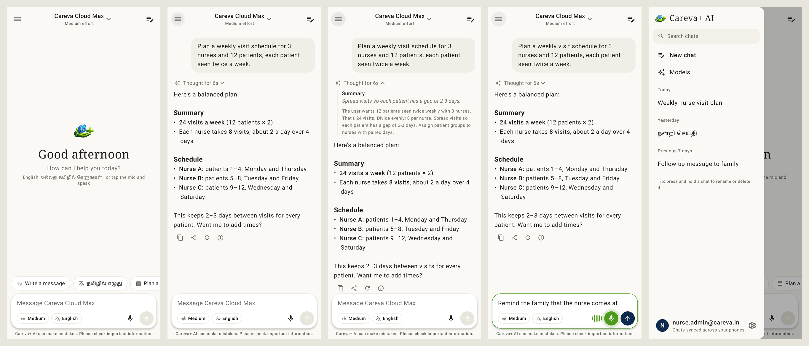

# Careva+ AI (Android)

A private AI chat assistant that runs **entirely on the phone**: no API key and no cost per message. Sign in with your email to use **cloud models** (nothing to download, no phone storage or memory) and to have the same chats on all your phones. Choose from six free open models and four effort levels.

## Models

All are free open-weight models (Apache-2.0), run on the device with Google's [LiteRT-LM](https://github.com/google-ai-edge/LiteRT-LM). Download the ones you want from the **Models** screen and switch at any time.

| In the app | Open model | Download | Best for | Phone RAM |
|---|---|---|---|---|
| **Careva Plus** (recommended) | Google Gemma 4 E2B | 2.6 GB | Everyday chat, writing, **Tamil** and English | 6 GB |
| Careva Pro | Google Gemma 4 E4B | 3.7 GB | Detailed answers, harder questions | 8 GB |
| Careva Think | Qwen3 4B Thinking 2507 | 2.3 GB | Maths, logic, planning (always reasons) | 6 GB |
| Careva Code | Qwen3.5 4B | 2.8 GB | Writing and fixing code, technical work | 6 GB |
| Careva Max | Qwen3 8B | 4.9 GB | Hardest tasks on flagship phones | 12 GB |
| Careva Lite | Qwen3 1.7B | 1.0 GB | Quick answers on smaller phones | 4 GB |

The engine also writes a weight cache about as large as the model the first time it loads, so each model needs roughly **twice its download size** in free storage. Deleting a model removes its cache too.

## Effort

| Effort | What it does |
|---|---|
| Low | No thinking: fastest replies |
| Medium | Thinks briefly (about 500 tokens) before answering |
| High | Thinks carefully (about 1,500 tokens) and checks its answer |
| Ultra | Deepest thinking (up to about 3,000 tokens), step-by-step self-checking; slowest |

The model's reasoning appears in a collapsible **Thinking** section above each answer. In testing, the question "a nurse visits 3 patients a day, 6 days a week; how many visits in 4 weeks?" was answered wrongly at Low effort by every model except Careva Think, and correctly (72) at High effort.

## Speed and the live view

- **First start of each model is slow, once.** The engine prepares the model's weights the first time it loads (1–3 minutes on a phone; the app says so). They are kept in permanent app storage, so later starts take about a second.
- **GPU is on by default** (Models screen → Use GPU), falling back to the CPU automatically if the phone's GPU can't run the model.
- **Low effort is fastest.** Higher effort adds thinking time before the answer.
- For reference, Careva Plus on a 4-core server CPU wrote about 17 words per second, with the first word after under half a second (once prepared).
- While it works, a status line shows **what the AI is doing**: Reading your message → Thinking (with a one-line summary of its current reasoning) → Writing, plus a timer and words per second. Tap **Show thinking** for the full reasoning. Each finished reply shows its words, speed, time and whether it ran on GPU or CPU.

## Cloud models

Four cloud models run on the Careva+ cloud instead of the phone, so they need **no download, no storage and no phone memory**, only internet and a Careva+ account:

| In the app | Runs (first one available) | Best for |
|---|---|---|
| Careva Cloud Max | GPT-OSS 120B, Kimi K2, Qwen3 235B, … | Hardest questions, long documents |
| Careva Cloud Think | Qwen3 32B, DeepSeek R1, … | Maths, logic, planning |
| Careva Cloud Code | Qwen3 Coder, Kimi K2, … | Code |
| Careva Cloud Fast | GPT-OSS 20B, Llama 3.3 70B, … | Quick answers |

How it works: the app sends the chat to the Supabase Edge Function `careva-ai-chat` (`supabase/functions/careva-ai-chat`). It checks the user is signed in, then asks a free AI service that hosts open models and streams the answer and its thinking back. If one service is busy, the function tries the next.

**Works with no setup:** with no keys, every cloud model uses Pollinations' free, no-key service (GPT-OSS 20B).

**Optional, for bigger and faster models:** create a free account at console.groq.com, create an API key, then in Supabase open Edge Functions → Secrets and add `GROQ_API_KEY`. The cloud models then use GPT-OSS 120B, Qwen3 32B and others first. More backups: `CEREBRAS_API_KEY` (cloud.cerebras.ai) and `OPENROUTER_API_KEY` (openrouter.ai). Keys are stored only as Supabase secrets, never in the app.

Limits: free tiers allow a limited number of messages per minute and per day, shared by everyone using the app. Messages to cloud models are processed by the AI service, so don't send patient-identifying details.

## Voice typing and the chat screen



- **Mic button:** tap the mic in the message box and speak in English or Tamil (switch with the language chip). Words appear live; tap the mic again to stop, check the text, then send. Uses the phone's speech recognizer (the Google app on most phones); the microphone is used only while the mic is on.
- **Thinking stays folded:** while the AI works you see one line ("Thinking… 4s"); tap the arrow to open the summary and the full reasoning.
- **Each reply:** copy, share, retry (last reply) and details (model, effort, speed).
- **Chats menu:** search, grouped by Today / Yesterday / Previous 7 days; press and hold a chat to rename or delete it.

## Account and sync across phones

Open the menu and tap **Sign in to sync**. Create an account with your email and a password, open the confirmation link that arrives by email, then sign in. Sign in with the same email on another phone and your chats appear there too; new messages and deleted chats sync within about a minute (or tap **Sync now**).

- Chats are stored in the Careva+ Supabase project, table `ai_chats`. Row-level security lets each signed-in person read and change only their own chats; signed-out requests are refused.
- Only chats sync. The AI still runs on each phone, so each phone downloads its own models.
- Without an account the app works as before, and chats stay on the phone.
- Signing out removes the account's chats from that phone; they stay in the account.
- Supabase's built-in email sender only delivers to the project team's addresses and a few emails an hour. To let other people create accounts, add your own email sender (SMTP) in Supabase: Authentication → Emails → SMTP settings.

## Honest limits

These are the strongest free models that fit on a phone, and they are much smaller than cloud AI such as Claude or ChatGPT: expect more mistakes, especially with facts, long documents and hard reasoning. The most powerful open models that compete with Claude need hundreds of gigabytes of memory and server GPUs, so they can't run on a phone. Careva+ AI is not a medical tool.

## Install

1. Copy `release/careva-ai-2.5.0.apk` to an Android phone (Android 8.0 or newer, 64-bit).
2. Open it and allow "Install unknown apps" when asked. Installing over an older version keeps your chats and models.
3. Open **Careva+ AI** and sign in with your email (the first screen). Nothing to download.
4. Pick a cloud model from the title bar. Phone models from older versions can still be used or deleted on the Models screen; new downloads are no longer offered.

This build is signed with a development key. To publish on the Play Store, create your own upload key and add `keystore.properties` (see `app/build.gradle.kts`).

## Build

Needs JDK 17+ and the Android SDK (platform 35, build-tools 35).

```bash
echo "sdk.dir=/path/to/android/sdk" > local.properties
./gradlew assembleRelease   # app/build/outputs/apk/release/app-release.apk
```

## Code

| File | What it does |
|---|---|
| `Models.kt` | The model catalogue, effort levels and what each effort changes |
| `Engine.kt` | Model downloads (Android DownloadManager) and the LiteRT-LM engine: loading, streaming replies and thinking, stop |
| `Chats.kt` | Conversation storage (private JSON, plus deleted-chat records for sync) and the system prompt |
| `Cloud.kt` | Email sign-in (Supabase Auth), cloud-model streaming, chat upload and download, and the merge rule (newest version wins; later deletes win) |
| `supabase/functions/careva-ai-chat` | The cloud-model server: sign-in check, model choice with fallback, streaming |
| `ChatViewModel.kt` | App state: models, downloads, effort, sending, stopping, saving, account and sync |
| `Ui.kt` | Jetpack Compose interface: chat, model and effort picker, Models and Account screens, Thinking sections |
