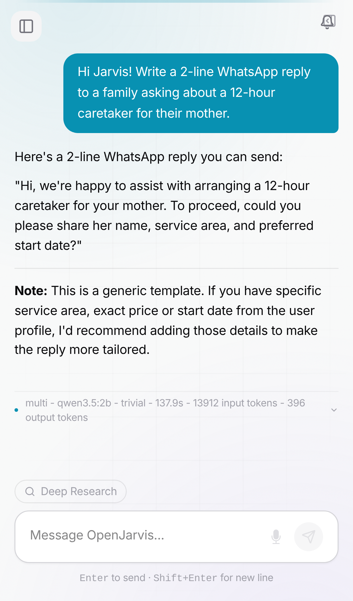
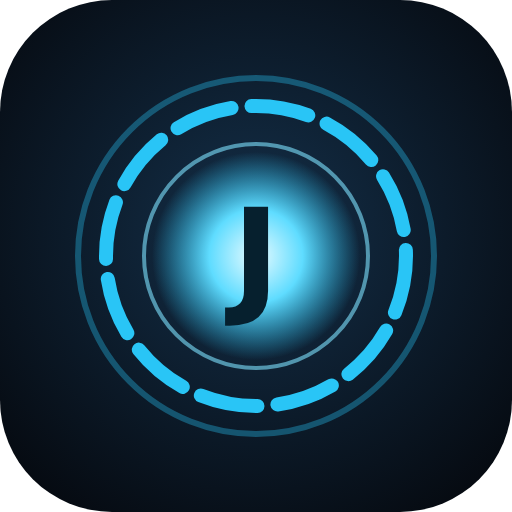

# Jarvis — AI assistant for Careva+

Jarvis is a personal AI assistant built on [OpenJarvis](https://github.com/open-jarvis/OpenJarvis)
(Stanford's open-source, local-first assistant framework).
It runs **on your own computer**. Your patients' details never go to a cloud AI service.

Jarvis is set up to help with Careva+ work:

- replying to new patient and family enquiries
- follow-up reminders and WhatsApp / SMS / email drafts
- nurse and caretaker shift planning
- quotations, invoices, simple accounts
- marketing posts, staff notices, reports
- web research and reading/writing files on your computer

It remembers useful facts from your chats and keeps them only on your computer.

<p align="center"></p>
<p align="center"><i>A real reply from Jarvis (qwen3.5:2b model), shown on a phone-sized screen.</i></p>

## Install (one time)

You need an internet connection and about 5 GB of free disk space.

**Mac, Linux, or Windows with WSL2.** Open Terminal in this `jarvis` folder and run:

```bash
bash install-jarvis.sh
```

**Windows.** Open PowerShell in this `jarvis` folder and run:

```powershell
powershell -ExecutionPolicy Bypass -File .\install-jarvis.ps1
```

The script:

1. Runs the official OpenJarvis installer. This installs Python tools, [Ollama](https://ollama.com) (which runs the AI model), and the `qwen3.5:2b` model. Usage analytics are turned off.
2. Copies the Careva+ Jarvis personality and settings into `~/.openjarvis/` (on Windows, `%USERPROFILE%\.openjarvis\`). Any old settings are saved as `config.toml.backup`.

## Tell Jarvis about yourself

Open `~/.openjarvis/USER.md` and fill it in: your name, how Jarvis should address you, your city, services and prices, and office hours.
Jarvis reads this file every time it starts.

## Use Jarvis

Open a **new** terminal window, then:

| Command | What it does |
|---|---|
| `jarvis chat` | Talk to Jarvis in the terminal |
| `jarvis gui` | Talk to Jarvis in your web browser (see note below) |
| `jarvis ask "..."` | Ask a single question |
| `jarvis doctor` | Check that everything is working |

Things to try:

```bash
jarvis ask "Draft a polite WhatsApp reply to a family asking for a 24-hour caretaker for their father after surgery"
jarvis ask "Make a shift plan for 3 nurses covering 5 patients this week"
jarvis ask "Write an Instagram post about our home nursing service"
```

**Browser app (`jarvis gui`)** needs [Node.js 22](https://nodejs.org) and npm 11.
Node 22 comes with npm 10, so run `npm install -g npm@11` once first.
When the app first opens it asks about sharing usage data. Choose **Continue without sharing**.

## Android app (APK)



The **Jarvis** Android app works **without your computer**. Open ⚙ **Settings** and choose Jarvis's "brain":

| Brain | Cost | Good for | What it runs |
|---|---|---|---|
| **Groq** | Free | Speed: replies in about a second | GPT-OSS 120B, Llama 3.3 70B |
| **NVIDIA** | Free | The biggest open models | Kimi K3.1 Pro, Mistral Large 4 (1T), Nemotron 3 Ultra 550B |
| **OpenRouter** | Free (about 50 messages a day) | More free models | Nemotron 3 Ultra 550B, Gemma 4 31B |
| **Google Gemini** | Free tier | Fast, solid answers | Newest Gemini Flash |
| **Claude** | Paid, a little per message | The strongest answers | Claude Opus 5.5 (or Sonnet / Haiku) |
| **On this phone** | Free | Privacy, no internet needed | Qwen 3.5 2B (1.3 GB download) |
| **My computer** | Free | Your OpenJarvis setup | Whatever your computer runs |

**Recommended:** set up **Groq** for speed and **NVIDIA** for heavy questions, both free.

Turn on **Backup**, which is on by default. When one brain is busy or reaches its free limit, Jarvis automatically answers with another one you've set up.

The free models are very capable, but none of them matches Claude's top models.
Use Claude when quality matters most.

**Getting a free key** (about a minute each):

1. In Settings, open a brain's card and tap **Get free key ↗**.
2. Sign up, create an API key, and copy it.
3. Paste the key into the card.
4. Tap **Test**. You should see "✓ Works" and how long the reply took.
5. Tap ↻ to see every model available to you. **Auto** uses the best one.

**In the chat:**

- Replies appear word by word, with bold text and bullet points.
- Under each reply you'll find **Copy**, **Share** (to WhatsApp, SMS or email) and **Read** (spoken aloud).
- **Quick actions** above the message box start common Careva+ tasks: reply to an enquiry, follow-up, shift plan, quotation, invoice, social post, staff notice.
- Tap the status chip under the title to switch brains quickly. Tap ■ to stop a reply.
- The conversation is kept when you close the app. Tap **＋** to start a new one.
- Fill in **About you** in Settings (name, how to address you, city, services and prices). Every brain uses it.

**Install:** on your Android phone (Android 7.0 or newer), download [`android/Jarvis-Careva.apk`](android/Jarvis-Careva.apk) and open it.
If Android asks, allow your browser to **install unknown apps**.
If you installed an older Jarvis app before, this one installs over it.

**Privacy:**

- Online brains (Groq, NVIDIA, OpenRouter, Gemini, Claude) send your messages to that company.
- Free tiers may keep prompts; OpenRouter's free models in particular may log them.
- For sensitive patient details, use **On this phone** or **My computer**.
- Your keys and chats are stored only on the phone.

**Using the on-phone brain:**

1. In ⚙, choose **On this phone**.
2. Tap **Download model (1.3 GB)** while on Wi-Fi, and keep the app open.
   If the download stops, tap Download again and it continues where it left off.
3. After that it works with no internet at all.

The first reply takes a little longer while the model loads.
On a mid-range phone, expect a few words per second.
Always check prices and facts in its replies before sending them; small models make more mistakes.

**Using your computer as the brain (optional):**

1. On your computer, run `jarvis auth create-key` once.
2. Each time you want to use it, run `jarvis serve --host 0.0.0.0`.
3. In the app, choose **My computer** and enter the computer's address and the key.
   To find the address on Windows, run `ipconfig` and use the "IPv4 Address".

This only works on the same Wi-Fi.
Messages travel over your Wi-Fi without encryption, so use it only on Wi-Fi you trust.
After creating a key, paste the same key into the browser app's Settings (`jarvis gui`).

**Rebuilding the app from source:**

1. Run `android/build-native.sh` to build the on-phone AI engine (llama.cpp, for 64-bit ARM phones).
2. Run `android/build.sh` to build the APK.

## Use Jarvis on your phone (Telegram)

Works on Android and iPhone, at home or outside. Jarvis runs on your computer, and your phone talks to it through a private Telegram bot.

1. Install the free **Telegram** app on your phone.
2. On your computer, in this `jarvis` folder, run:
   - Mac / Linux: `bash setup-phone.sh`
   - Windows: `powershell -ExecutionPolicy Bypass -File .\setup-phone.ps1`

   The script tells you how to create your bot with **@BotFather** and find your ID with **@userinfobot**.
   Then it asks you to paste both.
3. Start Jarvis on your computer and leave it running:

   ```bash
   jarvis serve
   ```

4. On your phone, open your new bot in Telegram and type "Hi Jarvis".

Things to know:

- Only **your** Telegram account can talk to your Jarvis. Messages from anyone else are ignored.
- Your computer must stay switched on and awake, with `jarvis serve` running.
- The AI still runs on your computer, but messages travel through Telegram's servers.
  Avoid sending sensitive patient medical details over Telegram.
- To turn phone access off: `jarvis config set channel.enabled false`

## Make Jarvis smarter (optional)

The default model is small, so it runs on almost any laptop.
If your computer has 16 GB of RAM or more, switch to a bigger model:

```bash
ollama pull qwen3.5:9b
jarvis config set intelligence.default_model qwen3.5:9b
```

## Files in this folder

| File | Purpose |
|---|---|
| `home/SOUL.md` | Jarvis's personality and rules (edit to change how Jarvis behaves) |
| `home/USER.md` | Template for information about you |
| `home/config.toml` | Model, tools, memory and privacy settings |
| `install-jarvis.sh` / `install-jarvis.ps1` | One-command installers |
| `setup-phone.sh` / `setup-phone.ps1` | Connect Jarvis to Telegram for phone use |
| `android/Jarvis-Careva.apk` | Android app: Claude, Gemini, on-phone AI or your computer (source in `android/src` and `android/jni`) |

After you edit a file in `home/`, run the installer again to apply it.
It keeps your filled-in `USER.md`.
